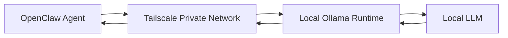

# OpenClaw Opportunity Watcher

A security-first autonomous research agent that uses local AI inference, evidence-grounded verification, and least-privilege design to discover and selectively surface high-value cybersecurity opportunities.

The project explores a broader engineering question:

> **How do you give an AI agent enough autonomy to perform useful research while keeping its authority, evidence boundaries, and blast radius tightly constrained?**

The operating principle is:

**SEARCH FREQUENTLY → VERIFY → FILTER AGGRESSIVELY → INTERRUPT RARELY**

This is a personal engineering project focused on local AI, agent orchestration, Zero Trust design principles, evidence provenance, and constrained autonomous systems.

**Status: Integration validation in progress.**

---

## Why This Project Exists

Many AI-assisted job-search workflows optimize for volume: find more listings, score more jobs, and generate more applications.

This project deliberately takes the opposite approach.

The Opportunity Watcher is designed as an **exception-detection system**.

Its purpose is to:

1. Discover potentially relevant opportunities.
2. Verify material facts against retrieved evidence.
3. Distinguish authoritative sources from aggregators and reposts.
4. Apply hard suppression rules before deeper analysis.
5. Evaluate surviving opportunities against explicitly approved candidate evidence.
6. Escalate only opportunities that warrant human attention.

**Zero alerts is an acceptable outcome.**

The system is intentionally prohibited from autonomously applying for positions, contacting recruiters, modifying professional materials, or expanding its own permissions.

The design philosophy is:

> **High initiative. Low authority.**

---

## Architecture

The implementation separates orchestration, inference, web discovery, and human decision authority.

### Local Inference Path



OpenClaw runs within a containerized orchestration environment while Ollama provides local inference from a separate system.

The model endpoint is not broadly exposed to the local network. Connectivity between the orchestration environment and inference service is provided through a private encrypted network overlay.

The logical inference path is:

**OpenClaw → Tailscale → Ollama → Local LLM**

### Discovery and Verification Path


Search results are treated as discovery evidence rather than automatically trusted facts.

Where stronger evidence is required, the agent retrieves the underlying source before making material claims.

---

## Trust Model

The system separates categories of information that autonomous agents can easily conflate.

### Trusted Candidate Evidence

Only explicitly approved evidence may establish candidate qualifications.

Examples include sanitized equivalents of:

- approved resume evidence
- approved professional-history supplements
- durable human decisions

A job description cannot establish that the candidate possesses the capabilities requested by the job.

### Untrusted External Content

Web pages, job descriptions, search results, aggregators, and retrieved documents are treated as **untrusted data**.

External content may provide evidence about an opportunity.

It does not provide instructions to the agent and cannot redefine its operating policy.

### Source Authority

Source authority is determined from the **actual retrieved source**, not from:

- employer names
- page branding
- search-result wording
- model knowledge
- claims made by an aggregator

An employer-controlled careers domain may be authoritative for the employer while a third-party job board remains a discovery source.

Importantly:

> **Source authority does not equal current opportunity status.**

An authoritative employer page can still describe a closed or expired opportunity.

---

## Verification Model

Material facts are intentionally separated from inference.

For opportunity status, the system uses states such as:

```text
VERIFIED OPEN
VERIFIED CLOSED
UNKNOWN
```

If current evidence cannot establish whether an opportunity is accepting applications, the system preserves the state as:

**UNKNOWN**

It does not convert uncertainty into a positive assertion simply because doing so would produce a more complete answer.

The same principle applies to material facts such as:

- location
- remote or hybrid status
- travel
- compensation
- qualifications
- organizational responsibility

Unknown is treated as a valid engineering state rather than a reasoning failure.

---

## Suppression Integrity

Hard filters execute before an opportunity is presented as a candidate.

An opportunity that fails a hard requirement may be retained internally for audit or deduplication purposes, but it must not appear in the final candidate-opportunity list.

A suppressed path looks like:

```text
DISCOVERED
    ↓
VERIFIED
    ↓
SUPPRESSED
```

A surviving opportunity follows a different path:

```text
DISCOVERED
    ↓
VERIFIED
    ↓
QUALIFIED FOR ANALYSIS
    ↓
NOTIFICATION GATE
```

This prevents a common agent failure mode: correctly identifying a disqualifying condition and then recommending the item anyway.

---

## Least-Privilege Agent Design

The Opportunity Watcher does not receive every capability available from the orchestration platform.

Its operational tool surface is intentionally narrow:

```text
read
ls
web_search
web_fetch
```

Capabilities unnecessary for the research mission are withheld.

The agent does not require autonomous access to:

- shell execution
- arbitrary file modification
- messaging
- additional agent creation
- infrastructure administration
- external account actions
- application submission

The security objective is not to prevent the model from reasoning autonomously.

It is to prevent reasoning autonomy from automatically becoming **execution authority**.

> **Autonomous research does not require autonomous authority.**

---

## Evidence Boundaries

A core requirement is preventing the model from turning desired job qualifications into fabricated candidate qualifications.

The system therefore maintains an explicit evidence hierarchy.

Approved candidate evidence can establish capability.

External job content cannot.

For example, if a job posting requires formal people management but approved candidate evidence establishes only strategic leadership, cross-functional leadership, program leadership, or executive advisory experience, the agent may not silently convert those into direct-report management.

Similarly, vendor-specific experience must not be invented simply because underlying domain expertise is transferable.

The system distinguishes between:

- directly supported capability
- transferable capability
- unsupported capability
- conflicting evidence
- unknown information

This keeps opportunity analysis grounded in evidence rather than optimized for a positive match.

---

## Provenance

Provenance is treated as part of the decision itself.

The system must not infer source authority from the employer named on a page.

For example:

```text
Employer named on page: Example Corp
Actual source: Third-party job board
Authority: THIRD PARTY
```

versus:

```text
Employer named on page: Example Corp
Actual source: Employer-controlled careers domain
Authority: EMPLOYER CONTROLLED
```

The authority classification follows the retrieved source.

It does not follow the branding.

When discovery and verification evidence conflict, stronger authoritative evidence is preferred when available.

If the conflict cannot be resolved, the system preserves:

**UNKNOWN**

---

## Operating Artifacts

The agent is implemented as a collection of operating artifacts rather than relying on a single monolithic prompt.

### `AGENTS.md`

Defines the sanitized operating program, including:

- mission
- evidence boundaries
- verification behavior
- hard filters
- uncertainty handling
- notification policy
- prohibited autonomous actions
- failure behavior

### `SEARCH_RULES.md`

Defines generalized discovery and verification policy, including:

- source-authority classification
- verification gates
- provenance requirements
- uncertainty preservation
- suppression integrity
- geography handling
- conflicting-evidence behavior

Private targeting strategy, employer preferences, compensation criteria, personal career rules, and role-specific calibration are intentionally excluded from the public version.

### `CASE_STUDY_TOOL_SEARCH.md`

Documents a significant orchestration failure discovered during implementation.

A local model repeatedly produced malformed tool operations through the agent runtime. Instead of assuming the LLM was incapable of reliable tool use, the execution path was decomposed and tested layer by layer.

Direct testing against Ollama demonstrated that the same model could produce valid native tool calls when OpenClaw's orchestration layer was bypassed.

Further isolation identified an unnecessary structured Tool Search abstraction between the model and its explicitly permitted tools.

After removing that indirection, a controlled test changed from repeated failures to:

```text
Tool calls: 1
Failures: 0
Result: Successful
```

**Read the full case study:** [Diagnosing Local LLM Tool-Calling Failures in OpenClaw](./CASE_STUDY_TOOL_SEARCH.md)

---

## Key Engineering Lessons

### Agent Failures Are Not Always Model Failures

An agent failure can originate from:

- the model
- inference runtime
- provider or API adapter
- tool schema
- orchestration framework
- context construction
- tool abstraction
- session state
- external dependencies

Replacing the model before isolating these layers can hide the actual defect.

### Retrieval Is Not Verification

Finding a page and proving a material fact are different operations.

Discovery evidence should trigger verification rather than automatically become verified truth.

### Provenance Must Survive the Reasoning Chain

An agent can retrieve a third-party source and later accidentally describe the information as employer-verified.

Source identity therefore needs to remain attached to material claims throughout the workflow.

### Unknown Is a Valid State

Forcing binary conclusions from incomplete evidence increases hallucination risk.

`UNKNOWN` is intentionally modeled as a legitimate outcome.

### Behavioral Instructions Are Not Security Controls

A prompt saying "do not perform an action" provides behavioral guidance.

Withholding the capability to perform that action provides the stronger technical control.

The system therefore combines behavioral policy with technical least privilege.

### More Capable Models Are Not a Substitute for Architecture

A larger model may compensate for unnecessary orchestration complexity.

That does not make the architecture simpler, more deterministic, or more secure.

The objective is to expose only the complexity required to perform the mission.

---

## Validation Completed

The following components have been individually validated:

- dedicated agent workspace
- local LLM inference
- private orchestration-to-inference connectivity
- restricted model endpoint exposure
- least-privilege tool surface
- workspace document retrieval
- candidate-evidence boundaries
- web discovery
- web retrieval
- source-authority rules
- uncertainty handling
- geographic suppression rules
- suppression integrity rules
- evidence hierarchy
- tool-calling failure isolation
- direct inference-runtime tool testing
- orchestration-layer workaround
- controlled policy-compliance testing

Controlled policy testing demonstrated correct interpretation of the core source-authority, suppression, geography, and `UNKNOWN` requirements when the relevant policy artifact was explicitly loaded.

---

## Integration Validation in Progress

The remaining work is primarily concerned with proving that individually validated components behave consistently when combined into an unattended workflow.

### Required Context Loading

Confirm that autonomous executions consistently load required operating and evidence artifacts before making material decisions.

### End-to-End Verification

Validate the complete sequence:

```text
Discovery
→ Source Verification
→ Current Status
→ Geography
→ Hard Filters
→ Evidence Analysis
→ Notification Gate
```

### Candidate Evidence Integration

Validate live opportunities against approved candidate evidence without allowing external job requirements to become fabricated candidate capabilities.

### Notification Gate

Demonstrate that mediocre opportunities remain silent while genuinely high-potential exceptions are escalated for human review.

Zero notifications remains an acceptable result.

### Persistent State and Deduplication

Introduce structured state for information such as:

- canonical opportunity identifier
- source URL
- first-seen timestamp
- last verification
- disposition
- suppression reason
- alert status

This prevents repeated searches from repeatedly consuming inference resources or human attention.

### Concurrency Control

Prevent overlapping autonomous runs from competing for the same local inference resources or contaminating validation results.

### Unattended Execution

Scheduled autonomous execution will be enabled only after interactive behavior is sufficiently reliable.

### Security Hardening

Execution permissions and surrounding runtime controls will receive a final review after functional integration is stable.

### Model Benchmarking

The current local model remains the baseline.

Larger models may later be benchmarked using the exact same validation suite rather than being assumed superior based solely on parameter count.

---

## Security Principles

The project applies several principles commonly used in enterprise security architecture:

- least privilege
- explicit trust boundaries
- evidence provenance
- separation of duties
- minimized blast radius
- human approval for consequential actions
- fail safely under uncertainty
- deterministic controls around probabilistic reasoning
- private-by-default service exposure
- auditable decision boundaries

The LLM is treated as a reasoning component inside the system — **not as the system's security boundary**.

---

## What This Project Is Not

This project is not:

- an automated application bot
- a resume spam system
- a recruiter-contact bot
- an autonomous career decision maker
- a general-purpose privileged AI agent

It is an experiment in building a **constrained autonomous research system** where the agent is allowed to investigate aggressively but must earn escalation through evidence.

---

## Repository Structure

```text
.
├── README.md
├── CASE_STUDY_TOOL_SEARCH.md
├── AGENTS.md
├── SEARCH_RULES.md
└── docs/
    └── architecture.md
```

> **Note:** Some artifacts shown above are planned and will be added as the public documentation is sanitized and finalized.

Personal evidence, private targeting criteria, infrastructure identifiers, authentication material, machine-specific details, and operational secrets are intentionally excluded.

---

## Privacy and Publication Boundaries

The public repository intentionally does not contain:

- personal resume data
- private professional-history evidence
- private career strategy
- employer targeting lists
- compensation thresholds
- private role calibration
- IP addresses
- private hostnames
- authentication tokens
- API keys
- account identifiers
- machine-specific configuration
- private network identifiers

The published artifacts document the transferable engineering methodology without exposing the private operational environment.

---

## Current Status

**Integration validation in progress.**

The architecture, local inference path, restricted tool model, web discovery, evidence retrieval, and core policy interpretation have been validated independently.

The current engineering focus is ensuring those controls remain reliable during longer autonomous workflows before enabling unattended production-style scheduling.

That distinction is intentional:

> **A system producing plausible answers is not the same as a system that has demonstrated trustworthy behavior.**

---

## Core Principle

The objective is not maximum automation.

The objective is **controlled autonomy**.

**SEARCH FREQUENTLY → VERIFY → FILTER AGGRESSIVELY → INTERRUPT RARELY**
