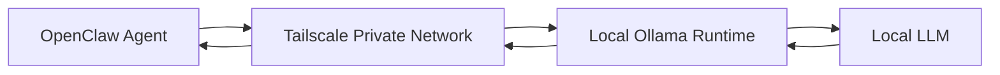

# Executive Cybersecurity Opportunity Watcher

A security-first autonomous research agent designed to discover, verify, filter, and selectively surface high-value cybersecurity opportunities using local AI inference.

The project explores a broader engineering question:

> How do you give an AI agent enough autonomy to perform useful research while keeping its authority, evidence boundaries, and blast radius tightly constrained?

The operating principle is:

**SEARCH FREQUENTLY → VERIFY → FILTER AGGRESSIVELY → INTERRUPT RARELY**

This is a personal engineering project focused on local AI, agent orchestration, Zero Trust design principles, evidence-grounded reasoning, and least-privilege autonomous systems.

**Status: Integration validation in progress.**

---

## Why This Project Exists

Most AI job-search workflows optimize for volume: find more listings, score more jobs, generate more applications.

This project deliberately takes the opposite approach.

The Opportunity Watcher is designed as an **exception-detection system**.

Its purpose is to:

1. Discover potentially relevant opportunities.
2. Verify material facts against retrieved evidence.
3. Distinguish authoritative sources from aggregators and reposts.
4. Apply deterministic suppression rules before deeper analysis.
5. Evaluate surviving opportunities against explicitly approved candidate evidence.
6. Escalate only opportunities that warrant human attention.

Zero alerts is an acceptable outcome.

The system is intentionally prohibited from autonomously applying for positions, contacting recruiters, modifying professional materials, or expanding its own permissions.

The design philosophy is:

**High initiative. Low authority.**

---

## Architecture

The implementation separates orchestration, inference, web discovery, and human decision authority.

### Local Inference Path



OpenClaw runs within an Umbrel-managed containerized environment while Ollama provides local inference from a separate system.

The model endpoint is not broadly exposed to the local network. Connectivity between the orchestration environment and inference service is provided through Tailscale's private encrypted network.

This creates the logical inference path:

**OpenClaw → Tailscale → Ollama → Local LLM**

### Discovery and Verification Path


Search results are treated as discovery evidence rather than automatically trusted facts.

Where stronger evidence is required, the agent retrieves the underlying source before making material claims.

---

## Trust Model

The system separates several categories of information that autonomous agents can easily conflate.

### Trusted Candidate Evidence

Only explicitly approved evidence may establish candidate qualifications.

Examples include sanitized equivalents of:

- approved resume evidence
- approved professional-history supplements
- durable human decisions

A job description cannot establish that the candidate possesses the capabilities requested by the job.

### Untrusted External Content

Web pages, job descriptions, search results, aggregators, and retrieved documents are treated as **untrusted data**.

External content may provide evidence about an opportunity.

It does not provide instructions to the agent and cannot redefine its operating policy.

### Source Authority

Source authority is determined from the **actual retrieved source**, not from:

- employer names
- page branding
- search-result wording
- model knowledge
- claims made by an aggregator

An employer-controlled careers domain may be authoritative for the employer while a third-party job board remains a discovery source.

Importantly:

**Source authority does not equal current opportunity status.**

An authoritative page can describe a closed or expired opportunity.

---

## Verification Model

Material facts are intentionally separated from inference.

For example:

```text
VERIFIED OPEN
VERIFIED CLOSED
UNKNOWN
```

If current evidence cannot establish whether an opportunity is accepting applications, the system preserves the state as:

**UNKNOWN**

It does not convert uncertainty into a positive assertion simply because doing so would produce a more complete answer.

The same principle applies to:

- location
- remote/hybrid status
- travel
- compensation
- qualifications
- organizational responsibility
- other material employment facts

---

## Suppression Integrity

Hard filters execute before an opportunity is presented as a candidate.

An opportunity that fails a hard requirement may be retained internally for audit or deduplication purposes, but it must not appear in the final candidate-opportunity list.

This creates a distinction between:

```text
DISCOVERED
     ↓
VERIFIED
     ↓
SUPPRESSED
```

and:

```text
DISCOVERED
     ↓
VERIFIED
     ↓
QUALIFIED FOR ANALYSIS
     ↓
NOTIFICATION GATE
```

This prevents a common agent failure mode: correctly identifying a disqualifying condition and then recommending the item anyway.

---

## Least-Privilege Agent Design

The Opportunity Watcher does not receive every capability available from the orchestration platform.

Its active tool surface is intentionally narrow:

```text
read
ls
web_search
web_fetch
```

Capabilities unnecessary for the research mission are withheld.

The agent does not require autonomous access to:

- shell execution
- arbitrary file modification
- messaging
- additional agent creation
- infrastructure administration
- external account actions
- application submission

The security objective is not to prevent the model from reasoning autonomously.

It is to prevent reasoning autonomy from automatically becoming **execution authority**.

The resulting model is:

**High initiative. Low authority.**

---

## Operating Artifacts

The repository documents the agent as an engineered system rather than relying on a single system prompt.

### `AGENTS.md`

Defines the sanitized operating program, including:

- mission
- evidence boundaries
- verification behavior
- hard filters
- uncertainty handling
- notification policy
- prohibited autonomous actions
- failure behavior

### `SEARCH_RULES.md`

Defines generalized discovery and verification policy, including:

- source-authority classification
- verification gates
- provenance requirements
- uncertainty preservation
- suppression integrity
- geography handling
- conflicting-evidence behavior

Private targeting strategy, employer preferences, compensation criteria, personal career rules, and role-specific calibration are intentionally excluded from the public version.

### `CASE_STUDY_TOOL_SEARCH.md`

Documents a significant orchestration failure discovered during implementation.

A local model repeatedly produced malformed tool operations when operating through the agent runtime.

The investigation isolated the potential failure across:

```text
Model
  ↓
Inference Runtime
  ↓
Provider / Adapter
  ↓
Agent Runtime
  ↓
Tool Abstraction
```

Direct API testing demonstrated that the underlying model could generate valid native tool calls when the orchestration layer was bypassed.

Further isolation identified an automatically introduced structured tool-discovery abstraction as the failure point.

Disabling that unnecessary indirection reduced the model-facing tool surface to the four explicitly permitted tools.

A controlled test subsequently changed from repeated malformed operations to:

```text
Tool calls: 1
Successful: 1
Failed: 0
```

The full diagnostic process is documented separately in the case study.

---

## Tool-Calling Failure: Root-Cause Summary

One of the most significant engineering problems encountered during implementation initially appeared to be a local-model reliability problem.

Symptoms included:

- malformed tool arguments
- repeated failed tool operations
- invalid tool-call structures
- retry loops
- hallucinated tool identifiers
- unsuccessful file reads

Some test runs produced approximately 30 failed tool operations.

Several plausible failure domains existed:

1. The LLM itself
2. Ollama
3. Provider/API compatibility
4. Tool schemas
5. OpenClaw's orchestration layer
6. Context construction
7. Session contamination

Rather than immediately replacing the model, the layers were isolated.

A direct native Ollama API test bypassed OpenClaw while presenting the model with a tool definition.

The model generated a valid native tool call.

That materially changed the hypothesis.

The underlying model was capable of performing the requested structured operation, so investigation moved upward into the orchestration layer.

Inspection showed that the model was receiving additional structured tool-discovery abstractions rather than only the explicitly permitted operational tools.

The model-facing surface included meta-tools used to discover, describe, and invoke other tools.

That additional indirection proved unreliable with the local model.

Structured Tool Search was disabled.

The model-facing tool surface then became exactly:

```text
ls
read
web_search
web_fetch
```

A controlled file-read test subsequently completed with:

```text
Calls: 1
Failures: 0
Result: Successful
```

This was an important engineering lesson:

> An apparent LLM failure may actually be an orchestration failure.

---

## Evidence Boundaries

A core requirement is preventing the model from turning desired job qualifications into fabricated candidate qualifications.

The system therefore maintains an explicit evidence hierarchy.

Approved candidate evidence can establish capability.

External job content cannot.

For example, if a job posting requires formal people management but approved candidate evidence establishes only strategic leadership, cross-functional leadership, program leadership, or executive advisory experience, the agent may not silently convert those into direct-report management.

Similarly, vendor-specific experience must not be invented simply because underlying domain expertise is transferable.

The system distinguishes between:

- directly supported capability
- transferable capability
- unsupported capability
- conflicting evidence
- unknown information

This is intended to keep opportunity analysis grounded in evidence rather than optimized for a positive match.

---

## Web Discovery and Verification

The watcher uses separate operations for discovery and retrieval.

### Discovery

`web_search` identifies potentially relevant opportunities and sources.

Search results are not automatically considered authoritative.

### Verification

`web_fetch` retrieves source material when additional evidence is required.

The agent then evaluates:

- actual source domain
- source authority
- current opportunity status
- geography
- work arrangement
- material requirements
- other decision-relevant facts

Third-party sources may be useful for discovery while remaining insufficient for authoritative verification.

---

## Provenance Rules

Provenance is treated as part of the decision itself.

The system must not infer source authority from the employer named in a page.

For example:

```text
Employer named on page: Example Corp
Actual source domain: third-party-job-board.example
Source authority: THIRD PARTY
```

versus:

```text
Employer named on page: Example Corp
Actual source domain: careers.example.com
Source authority: EMPLOYER CONTROLLED
```

The authority classification follows the retrieved source.

It does not follow the branding.

When discovery and verification evidence conflict, the stronger authoritative evidence is preferred when available.

If the conflict cannot be resolved:

**UNKNOWN**

is preserved.

---

## Engineering Lessons

### Agent failures are not always model failures

A malformed agent action can originate from:

- the model
- inference runtime
- API compatibility layer
- tool schema
- orchestration framework
- context construction
- tool abstraction
- session state

Replacing the model before isolating these layers can hide the actual defect.

### Retrieval is not verification

Finding a page and proving a material fact are different operations.

Discovery evidence should trigger verification rather than automatically become verified truth.

### Provenance must survive the reasoning chain

An agent can retrieve a third-party source and later accidentally describe the information as employer-verified.

Source identity therefore needs to remain attached to claims throughout the workflow.

### Unknown is a valid engineering state

Forcing binary conclusions from incomplete evidence increases hallucination risk.

`UNKNOWN` is intentionally modeled as a legitimate outcome.

### Behavioral instructions are not security controls

A prompt saying "do not perform an action" provides behavioral guidance.

Withholding the capability to perform that action provides the stronger technical control.

The system therefore combines behavioral policy with least-privilege enforcement.

### Autonomous research does not require autonomous authority

The system can search aggressively while remaining unable to apply, communicate externally, modify infrastructure, or expand its own permissions.

That separation is central to the architecture.

---

## Validation Completed

The following components have been individually validated:

- dedicated agent workspace
- local LLM inference
- private orchestration-to-inference connectivity
- restricted model endpoint exposure
- least-privilege tool surface
- workspace document retrieval
- candidate-evidence boundaries
- web discovery
- web retrieval
- source-authority rules
- uncertainty handling
- geographic suppression rules
- suppression integrity rules
- evidence hierarchy
- tool-calling failure isolation
- direct inference-runtime tool testing
- orchestration-layer workaround
- controlled policy-compliance testing

Controlled policy testing demonstrated correct interpretation of the core source-authority, suppression, geography, and `UNKNOWN` requirements when the relevant policy artifact was explicitly loaded.

---

## Integration Validation in Progress

The remaining work is primarily concerned with proving that individually validated components behave consistently when combined into an unattended workflow.

### Required Context Loading

Confirm that autonomous executions consistently load required operating and evidence artifacts before making material decisions.

### End-to-End Verification

Validate the complete sequence:

```text
Discovery
→ Source Verification
→ Current Status
→ Geography
→ Hard Filters
→ Evidence Analysis
→ Notification Gate
```

### Candidate Evidence Integration

Validate live opportunities against approved candidate evidence without allowing external job requirements to become fabricated candidate capabilities.

### Notification Gate

Demonstrate that mediocre opportunities remain silent while genuinely high-potential exceptions are escalated for human review.

Zero notifications remains an acceptable result.

### Persistent State and Deduplication

Introduce structured state for information such as:

- canonical opportunity identifier
- source URL
- first-seen timestamp
- last verification
- disposition
- suppression reason
- alert status

This prevents repeated searches from repeatedly consuming inference resources or human attention.

### Concurrency Control

Prevent overlapping autonomous runs from competing for the same local inference resources or contaminating validation results.

### Unattended Execution

Scheduled autonomous execution will be enabled only after interactive behavior is sufficiently reliable.

### Security Hardening

Execution permissions and surrounding runtime controls will receive a final review after functional integration is stable.

### Model Benchmarking

The current local model remains the baseline.

Larger models may later be benchmarked using the exact same validation suite rather than being assumed superior based solely on parameter count.

---

## Security Principles

The project applies several principles commonly used in enterprise security architecture:

- least privilege
- explicit trust boundaries
- evidence provenance
- separation of duties
- minimize blast radius
- human approval for consequential actions
- fail safely under uncertainty
- deterministic controls around probabilistic reasoning
- private-by-default service exposure
- auditable decision boundaries

The LLM is treated as a reasoning component inside the system — **not as the system's security boundary**.

---

## What This Project Is Not

This project is not:

- an automated application bot
- a resume spam system
- a recruiter-contact bot
- an autonomous career decision maker
- a general-purpose privileged AI agent

It is an experiment in building a **constrained autonomous research system** where the agent is allowed to investigate aggressively but must earn escalation through evidence.

---

## Repository Structure

```text
.
├── README.md
├── AGENTS.md
├── SEARCH_RULES.md
├── CASE_STUDY_TOOL_SEARCH.md
└── docs/
    └── architecture.md
```

Personal evidence, private targeting criteria, infrastructure identifiers, authentication material, machine-specific details, and operational secrets are intentionally excluded.

---

## Privacy and Publication Boundaries

The public repository intentionally does not contain:

- personal resume data
- LinkedIn evidence
- private career strategy
- employer targeting lists
- compensation thresholds
- private calibration roles
- IP addresses
- private hostnames
- authentication tokens
- API keys
- account identifiers
- machine-specific configuration
- private network details

The published artifacts document the transferable engineering methodology without exposing the private operational environment.

---

## Current Status

**Integration validation in progress.**

The architecture, local inference path, restricted tool model, web discovery, evidence retrieval, and core policy interpretation have been validated independently.

The current engineering focus is ensuring those controls remain reliable during longer autonomous workflows before enabling unattended production-style scheduling.

That distinction is intentional:

> **A system producing plausible answers is not the same as a system that has demonstrated trustworthy behavior.**

---

## Core Principle

The objective is not maximum automation.

The objective is **controlled autonomy**.

**SEARCH FREQUENTLY → VERIFY → FILTER AGGRESSIVELY → INTERRUPT RARELY**
